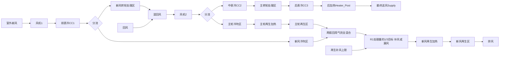

# 2026-11-11 末端调温与分区加权优化

本文件记录用户最新有效要求，替代此前没有末端调温、没有送风温度目标的优化口径。此前报告不删除，作为历史追溯；不能把旧四负荷模型的最优数字直接当作本次结果。本轮只保留本机，不提交或推送GitHub。

## 目标和范围

用户本次指定送风温度**−35℃**，送风露点**−45℃**，露点只允许**±1℃**误差，即−46～−44℃（含边界）。控制搜索必须同时给这两个目标，按末端处理后的最终Supply验收。

本轮不重新训练新风或主轮，不修改已安装权重、scaler、原始数据与分区。主轮训练覆盖和既有守恒问题按用户决定继续暂缓。原入口状态、风量、压力、转轮尺寸和转速保持；外层仍搜索CC1、CC2和两台再生加热器温度。末端冷/热按给定送风温度自动运行，不增加两个独立末端设定作为搜索变量。

## 新拓扑与按需开关



后表冷和后加热串联在主转轮处理出口与送风口之间，使用同一个目标送风温度：

| 主转轮处理出口与目标相比 | CC3后表冷 | Heater_Post后加热 |
|---|---|---|
| 温度更高 | 冷却至目标 | 0负荷 |
| 温度更低 | 0负荷 | 加热至目标 |
| 温度相同 | 0负荷 | 0负荷 |

后表冷复用现有CoolingCoil的压力、饱和与凝结计算，后加热等湿，负荷均按空气焓差计算。若CC3凝结，最终含湿量和露点会改变，因此不能再用主轮原处理出口露点作为送风验收值。节点`AfterR2_P`保留主轮原出口，`AfterCC3`保留后表冷出口，`Supply`是后加热后的最终状态。

旧前向配置没有送风温度目标或显式给null时，两个末端组件兼容旁通；六项负荷键仍在，末端两项为0。优化与此不同：温度目标必须显式给出，不得悄悄采用示例温度。末端不回填转轮再生未知量，原联立求解max_iter60、relax0.8、T容差1e-4℃、W容差1e-6g/kg保持。

## 六项物理冷热负荷

| 类型 | 公开字段 |
|---|---|
| 三台表冷器 | CC1_kW、CC2_kW、CC3_kW，符号为负 |
| 三台加热器 | Heater_Low_kW、Heater_OA_kW、Heater_Post_kW，符号为正 |

```text
cooling_kW = |CC1| + |CC2| + |CC3|
heating_kW = Heater_Low + Heater_OA + Heater_Post
Q_sum = cooling_kW + heating_kW
```

所有开关判断后的真实负荷都计入Q_sum，关闭时也显式保存0键。Q_sum是物理热负荷之和，单位kW，不是已经换算COP/效率的整机电耗。仪表图同时展示六组件明细、冷热合计、目标温度和末端冷热开关，处理侧路径由原8节点扩展为10节点；旧JSON没有新增节点时仍按原路径重绘。

## 分区距离惩罚与最终loss

误差定义为`e = 最终预测送风露点 − 目标送风露点`。权重的边界归属明确如下：

| 露点误差e（℃） | w(e) |
|---|---:|
| −1≤e<−0.5 | 0.35 |
| −0.5≤e≤+0.3 | 0.1 |
| +0.3<e≤+1 | 0.5 |

−0.5和+0.3归中间段。越过±1℃直接不合格，惩罚不能替代硬约束。送风温度按目标误差≤1e-4℃验收；非有限状态、末态过饱和及闭环未收敛的候选也不能选为解。

用户后续确认先归一化能耗，并设置露点惩罚系数0.1：

```text
J = Q_sum / Q_ref + 0.1 × w(e) × |e| / (1℃)
```

本次固定**Q_ref=354.01652084694706kW**，来自原配置在同一−35℃送风目标下的六项总负荷。每次搜索只建立一次基准，所有候选共用，不能用各候选自己的负荷去归一化；初始基准计算失败须明确报错或要求显式基准，不自动换成下一候选。

J无量纲，是外层控制搜索的评分，不是物理热负荷，也不是KAN训练loss。选解、差分进化、坐标细化及独立复算都以相同J为准；物理Q_sum另列，并保留裸Q_sum最低候选。最小J与最小裸Q_sum可能是不同参数点，报告中不能混称，也不宣称全局最优或真实设备实测节能。

## 配置和CLI

前向schema v2增加可选字段：

```yaml
control_setpoints:
  # 其余原字段保持
  supply_T_target_degC: -35.0
```

运行时字段为`ControlSetpoints.supply_T_target`。不覆盖三份原工况YAML；优化保存的最优配置会携带本次送风目标，可直接传给原simulate入口。

```powershell
conda run --no-capture-output -n dehumidifier python -m dual_rotor_sim.cli optimize --config simulation/configs/default_case.yaml --dew-point-target -45 --dew-point-tolerance 1 --supply-temp-target -35 --dew-point-penalty-coefficient 0.1 --output-dir results/simulation/新的末端优化目录 --json
```

`--dew-point-target`和`--supply-temp-target`均必填；`--dew-point-tolerance`默认1且不能超过1。`--energy-reference`可显式指定正的固定kW基准，缺省按原配置与本次送风温度计算；复现本次同模型、同工况可显式传`--energy-reference 354.01652084694706`，换工况不能盲目照抄。`--dew-point-penalty-coefficient`默认0.1。兼容的冷热权重参数只能为1，以保持用户定义的六项之和。

控制边界仍为CC1 9～13℃、CC2 13～17℃、两再生加热各50～140℃，默认0.1℃分辨率；这些是本次搜索范围，不是厂家硬件极限。`--initial-controls`仅提供四个搜索起点温度，仍用当前模型重新评价。输出目录须为新目录，拒绝覆盖；无可行点或独立复算失败退出5。

## 验证、部署和证据

末端专项10项、优化专项58项通过，最新完整回归253通过、35项按既有规则跳过。新末端、六负荷结果序列化、历史JSON绘图兼容、最终Supply验收、分区边界、归一化固定基准及J排序均有对应检查。不要把缺外部资料的skip写成模型验收通过。

Python与C#的末端配置、拓扑、六负荷及相关源码契约已同步；本机没有dotnet，未编译或运行新的C# DLL，现有NuGet1.0.1不自动含本次功能。新增优化入口仍为Python，源码同步不等于跨语言严格数值迁移已通过。

本机当前结果目录为`results/simulation/20261111_末端调温与加权优化`。完整搜索过程、六项物理负荷、距离惩罚、J、归一化基准及权重/数据/源码身份，以该次报告和JSON为准。

## 本次搜索结果

完成150组试跑、4049组正式三种子搜索及112组候选合并细化。三个运行各自计数，跨运行有重复，不能将三者之和称为全部唯一组合。合并细化保留试跑中的最佳候选，正式三种子没有找到更低J；以下仅为本次已评估中的最低J候选，不是全局最优证明。

| 控制参数 | 设定（℃） |
|---|---:|
| CC1前表冷出口 | 9.1 |
| CC2中表冷出口 | 16.2 |
| Heater_OA新风转轮再生加热 | 98.5 |
| Heater_Low主转轮再生加热 | 91.7 |
| 最终送风温度目标 | −35 |

| 最终Supply及评分 | 结果 |
|---|---:|
| 送风温度（℃） | −35 |
| 送风露点（℃） | −45.06138393727244 |
| 相对−45℃的误差（℃） | −0.06138393727244 |
| 送风含湿量（g/kg） | 0.044093080313637824 |
| 总冷负荷（kW） | 305.22670472229066 |
| 总加热负荷（kW） | 25.81133112618738 |
| 六项物理负荷和Q_sum（kW） | **331.03803584847805** |
| 固定Q_ref（kW） | 354.01652084694706 |
| 最终无量纲评分J | **0.9357058939935217** |
| 联立迭代次数 | 16 |

本点处于中间权重区间，w(e)=0.1，距离惩罚约0.000613839373；物理负荷归一化项约0.935092054621。两者相加为J，不把距离惩罚计为kW。原默认归一化基准的露点不在目标带，负荷比不能直接当成同等送风服务的实测节能率。

2026-11-13中断后完成最终核验：三个运行合计4311条，按四控制去重4137点，119点可行。裸Q最低点9.1/16.2/98.5/91.4℃的Q=331.01949922851236kW、露点−44.1150497379753℃；采用最小J方案只增加0.01853661996569kW，露点回到−45.061384℃。同一119点候选池在λ=0.01/0.1/1重评分均选该最小J点，这不是三次独立重搜。

重新加载真实模型后，最小J及最小Q点均独立复算匹配；新增末端1643项逐迭代和物理记账检查0失败，公开simulate入口使用最优YAML退出0。两模型原始湿度均非负、最终无过饱和。水量余额+0.627023kg/h（0.458696%）、焓余额−3.786658kW仍与两转轮余额一致，只作诊断，未修复既有非守恒。23份保护文件和27份仿真源码SHA与搜索时相同，未重训或改数据。完整[本机报告](../../results/simulation/20261111_末端调温与加权优化/末端调温与分区加权优化报告.md)、[最优参数](../../results/simulation/20261111_末端调温与加权优化/最优控制参数.yaml)、[独立核验](../../results/simulation/20261111_末端调温与加权优化/独立前向与物理记账核验.json)已归档；最新前向记录为`results/simulation/20261113_011625_211554_最优控制参数`。源码仍仅本机，C#未编译限制不变。

历史单边约−92℃和10.67%结论仍无效；后续双边但无末端的4044组、146.283443kW，以及871组边界诊断保留追溯，均不是本次−35℃送风温度与分区复合目标下的最优结果。旧资料入口：[双边纠错](2026-11-11-露点双边误差约束更正.md)、[未加末端的拓扑诊断](2026-11-11-优化拓扑与露点边界诊断.md)。主轮覆盖、整机实测精度和守恒问题继续保留，未因本轮增加末端而自动解决。
