# 最终系统拓扑与物理契约

权威实现为simulation/dual_rotor_sim/core/system/system.py、config.py与psychrometrics.py；C#在deployment/dotnet/src/Dehumidifier.Simulation。以下为用户确认的最终企业规则，已同时存在于Python/C#。

## 气路

```mermaid
flowchart LR
 OA[室外新风] --> F1[Fan1] --> CC1[CC1] --> S1{分流}
 S1 --> R1P[R1处理区] --> M1[混入房间回风] --> F2[Fan2] --> S2{分流}
 RA[回风] --> M1
 S2 --> CC2[CC2] --> R2P[R2处理区] --> SUP[送风]
 S2 --> R2CB[R2冷吹] --> HL[HeaterLow] --> R2RG[R2再生]
 S1 --> R1CB[R1冷吹]
 R2RG --> REC[两股回用气完全混合]
 R1CB --> REC
 REC --> RULE{目标R1处理量/3}
 RULE -->|超量| VENT[排出多余混合气]
 RULE --> USE[保留混合气]
 ROA[再生新风 可用上限] -->|不足时补风| USE
 USE --> HOA[HeaterOA] --> R1RG[R1再生] --> EXH[排放]
 HOA -. 实际T与W回填 .-> R1P
 HL -. 实际T回填 .-> R2P
```



R1=新风，R2=主转轮；每台一个固定六输出KAN，同时预测三个区出口T/W。图中分区不是独立模型。R2冷吹在CC2前分流，其出口经HeaterLow进入R2再生；R1处理出口只与房间回风混合，不进入再生回用混合。

## 五个边界流量与企业混风

独立配置：outdoor_air、return_air、regen_outdoor_air以及rotor1/rotor2冷吹流量。YAML单位m³/h；前四个非补风边界须正数，再生补风可为0但不能为负/非有限。

build_runtime_inputs统一调用SimulationConfig.m3h_to_kg_da_s，按同一室外新风参考干空气密度换算kg干空气/s。密度：w=W_oa/1000，p_da=P*0.622/(0.622+w)，rho=p_da/[287.05*(T_oa+273.15)]，mdot=Q*rho/3600。不能为每个支路复制不同换算。

```text
R1_process = OA - R1_cold_blow
Fan2_total = R1_process + RA
R2_process = Fan2_total - R2_cold_blow = Supply
R2_regen = R2_cold_blow
regen_target = R1_process / 3
available = R2_regen + R1_cold_blow
```

先把available的两股气完全混合，保证漏出的和保留的成分相同：

- available≥target：关闭新风补风，排出available-target，送往HeaterOA的流量=target。
- available<target：补风=min(target-available,配置可用上限)，实际流量=available+补风。
- 上限不足或0：继续计算，实际流量低于目标，warning并记录shortfall；小于1e-9kg/s的浮点缺口视作0。

配置的regen_outdoor_air是补风上限，不能无条件全部混入。KAN新风再生风量输入必须是规则执行后的实际值。分支、目标、可用量、补/漏风与缺口记录在result.regen_mix_rule中。三份真实YAML不为模型修改。

## 模型输入与输出

正式仅加载artifacts/kan_xf_single和kan_main_single，不路由、不fallback。输入列严格保序：

```text
XF 10列：
转轮厚度, 转轮直径, 处理入口温度(℃), 入口含湿量(g/kg), 处理风量,
冷吹风量, 转轮转速(rpm), 再生温度(℃), 再生风量, 再生入口含湿量
main 9列：
转轮厚度, 转轮直径, 入口含湿量(g/kg), 转轮转速(rpm), 再生温度(℃),
冷吹入口温度(℃), 处理入口温度(℃), 处理风量, 冷吹风量
六输出：处理/冷吹/再生出口温度和含湿量（按此顺序成对）
```

几何mm、温度℃、W为g/kg干空气、转速rpm，所有模型风量m³/h。输入风量由真实质量流量按同一参考密度反算；YAML风速字段只兼容保留，不参与KAN。扇区角度与压力不属于KAN特征，main无显式再生入口W/流量特征，不能高估模型对这些自由度的辨识能力。power和Excel露点不进入张量，处理出口露点由预测W派生。

架构XF[10,24,6] grid6/order3，main[9,16,6] grid5/order3。输入/目标MinMax(-1,1)、clip=false；仅处理出口W做log1p/expm1。加载器校验profile、列、架构、scaler，并支持候选network.权重前缀。仿真对负湿度投影到0，训练原始指标仍不可裁剪。

## 联立求解和记录

三个未知量是R1实际再生入口T、W与R2实际再生入口T。每轮使用这三个值预测，按完整气路重算实际入口F(x)，检查未松弛残差F(x)-x，再更新x_next=x+0.8*(F(x)-x)。max_iter60，温度容差1e-4℃，W容差1e-6g/kg。自然满足加热设定点时Q=0，实际入口T可以高于设定温度，不能强行钳到设定值。

正式forward_simulate走simulate_coupled_xf。直接simulate只是单次顺序计算，不能作为稳态收敛证据。convergence含status、converged、iterations、last_evaluated_inputs、residuals、tolerances、每轮history及solver_parameters；所有最终输出对应末次实际计算输入，不是尚未计算的松弛后猜测。补风不足warning不等同数值未收敛。

## 物性、压力和露点

T≤0℃饱和压按企业冰面多项式，T>0℃液态水，含湿量公式水汽比0.62198。压力贯穿全部状态，混合不同压力报错；保留的流量参考密度常量0.622与湿空气比0.62198不同，不能随意统一。

露点函数虽沿用dew_point_water_C名称，低湿区已执行企业DptAH契约：88项，DptAH[i]对应-i℃，覆盖0至-87℃，标准压101325Pa标定。W≤3.764且>0时区间线性插值，0<W<0.0001时末段线性外推；W>3.764时按公式数值反演；W=0返回-inf。表中-19℃对应0.741按原规格保留。25℃、W=0.138g/kg时露点=-35℃，不能恢复旧公式的-38.3261℃。

DptAH低湿查表不随压力重标定，因此虽压力字段贯穿，低湿表对非标准压不能声称物理自洽。反向humidity_ratio_from_dew_point_C须采用同一表。-inf是合法干燥极限，JSON存null并结合W=0还原；NaN/+inf或非零W的-inf报错。

## 凝结、负荷、输出

表冷器T_out低于入口露点时有意凝结，W_out=min(W_in,W_sat(T_out))，不改回恒W。加热器/表冷器自然满足时Q=0正常。

仅公开CC1_kW、CC2_kW、Heater_Low_kW、Heater_OA_kW；CC为负，cooling=abs(CC1)+abs(CC2)，heating=两加热器和。这是热负荷，隐含冷量COP=1，不是电机/风机/整机直接电耗。

CLI与visualize每次JSON/PNG同目录results/simulation/<运行编号>/。未收敛保留调试记录并退出4，图和终端明确标识；历史缺字段只能未评估。展示调整调用save_dashboard_from_record从已有JSON重绘。源码、训练精度、数值收敛、跨语言严格迁移和工程物理验收必须分别举证。
