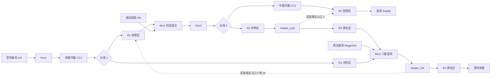

# 系统拓扑与物理契约

本文依据当前源码核对，供另一台电脑的 Agent 接手。项目处于模型联调阶段：代码回归、单转轮训练精度、系统数值收敛和工程物理验收是四件需要分别举证的事。

当前拓扑的权威实现是 [system.py](../../simulation/dual_rotor_sim/core/system/system.py)，配置及单位契约是 [config.py](../../simulation/dual_rotor_sim/config.py)。[系统建模 v1 方案](../reference/系统建模v1方案.md) 仅作历史参考，不能据此恢复旧拓扑或把表冷器改回恒含湿量。

## 1. v2 气路与模型边界

R1 是新风转轮，R2 是主转轮。两台转轮各有处理、冷吹、再生三个区；每台转轮由一个固定六输出 KAN 同时预测三个区的出口温度、含湿量。下图实线表示气流，虚线表示联立求解时回填的入口状态约束。



图中的 R1 三个区共用 R1 KAN，R2 三个区共用 R2 KAN。气流图的分区节点不代表另有六个独立模型。正式路径不读取逐输出 `routing.json`，不挑选候选模型，也不回退到历史 ensemble。

逐段气路与源码状态名如下：

| 气路 | 顺序及关键状态 |
| --- | --- |
| 室外侧 | `OA → AfterFan1 → AfterCC1`，在 CC1 后分为 `R1_P_in` 和 `R1_CB_in` |
| 新风处理 | `R1_P_in → AfterR1_P`，与 `RA` 混合为 `BeforeFan2`，经 Fan2 成为 `AfterFan2` |
| 主转轮处理 | `AfterFan2` 分出的处理流经 CC2 得到 `AfterCC2`，进入 R2 处理区，出口是 `Supply` |
| 主转轮冷吹及再生 | `AfterFan2 → R2_CB_in → AfterR2_CB → AfterHeaterLow → R2 再生区 → AfterR2_RG` |
| 新风冷吹 | `R1_CB_in → AfterR1_CB`，进入再生侧三股混风 |
| 新风再生 | `AfterR2_RG + RegenOA + AfterR1_CB → AfterMix3 → AfterHeaterOA → R1 再生区 → AfterR1_RG`，最后排放 |

三股混风由两次 `Mixer.mix` 实现：先主转轮再生出口加再生新风，再加新风转轮冷吹出口。新风转轮处理出口只参与房间回风混合，不能接入再生三股混风。主转轮冷吹在 CC2 前分出，不能把 CC2 后温度当作其冷吹入口温度。

## 2. 五个独立流量与单位

YAML 和 CLI 对外使用 `m³/h`，内部 `AirState.mdot` 使用 `kg 干空气/s`；含湿量始终是 `g/kg 干空气`，温度是 `℃`，压力是 `Pa`。`schema_version` 必须是 `2`，`flow_reference.basis` 必须是 `outdoor_air`。配置解析精确检查必填和未知字段，不静默补默认工况。

| 独立流量 | YAML 字段 | 内部符号 |
| --- | --- | --- |
| 新风总量 | `outdoor_air.flow_m3h` | `m_oa` |
| 房间回风量 | `return_air.flow_m3h` | `m_ra` |
| 再生补充新风量 | `regen_outdoor_air.flow_m3h` | `m_regen_oa` |
| R1 冷吹量 | `system_params.rotor1.cool_blow_flow_m3h` | `m_r1_cb` |
| R2 冷吹量 | `system_params.rotor2.cool_blow_flow_m3h` | `m_r2_cb` |

五个量全部经 `build_runtime_inputs` 调用 `SimulationConfig.m3h_to_kg_da_s`，使用同一个室外新风参考干空气密度。即使回风和再生气流的本地温湿度不同，也不能分别按各自状态重新换算这些配置风量。

```text
w_oa       = outdoor_air.W_g_per_kg / 1000
p_da       = pressure_Pa × 0.622 / (0.622 + w_oa)
rho_da_ref = p_da / [287.05 × (outdoor_air.T_degC + 273.15)]
mdot       = flow_m3h × rho_da_ref / 3600
```

其他流量由拓扑唯一派生：

```text
m_r1_p  = m_oa - m_r1_cb
m_fan2  = m_r1_p + m_ra
m_r2_p  = m_fan2 - m_r2_cb = m_supply
m_r2_rg = m_r2_cb
m_r1_rg = m_r2_rg + m_regen_oa + m_r1_cb
```

必须满足所有独立及派生支路流量为正、`m_r1_cb < m_oa`、`m_r2_cb < m_fan2`。主转轮再生量不能独立设置，必须等于其冷吹量。配置中的再生新风是三股混风中的补气，不能拿它单独当作 R1 再生总量。

R1 KAN 需要的 `再生风量` 使用 `m_r1_rg × 3600 / rho_da_ref`，仍是室外参考状态下的 `m³/h`。不要根据加热后的实际再生温度重新计算这个模型输入。`SimulationConfig.derived_flow_m3h` 可直接查看体积基准下的派生流量。

## 3. 双 KAN 的固定输入输出

正式加载入口为 [solver.py](../../simulation/dual_rotor_sim/core/system/solver.py) 的 `build_system()`，分别加载：

```text
artifacts/kan_xf_single/    → SingleRotorModel(profile="xf")   → R1
artifacts/kan_main_single/  → SingleRotorModel(profile="main") → R2
```

两个目录是本机训练或受控转移得到的运行时模型包，GitHub 代码交接不包含模型权重。缺任何一个包，或列/架构契约不符，正式仿真直接报错；测试用假模型通过不等于运行时模型已经准备完成。

输入数组列顺序是契约的一部分，即使维度相同也不能调换。没有派生特征：

| 序号 | R1：XF，新风转轮 10 输入 | R2：main，主转轮 9 输入 |
| --- | --- | --- |
| 1 | `转轮厚度`，mm | `转轮厚度`，mm |
| 2 | `转轮直径`，mm | `转轮直径`，mm |
| 3 | `处理入口温度(℃)` | `入口含湿量(g/kg)` |
| 4 | `入口含湿量(g/kg)` | `转轮转速(rpm)` |
| 5 | `处理风速(m/s)` | `再生温度(℃)` |
| 6 | `冷吹风速(m/s)` | `冷吹入口温度(℃)` |
| 7 | `转轮转速(rpm)` | `处理入口温度(℃)` |
| 8 | `再生温度(℃)` | `处理风速(m/s)` |
| 9 | `再生风量`，参考状态 m³/h | `冷吹风速(m/s)` |
| 10 | `再生入口含湿量`，g/kg | — |

R1 的处理及冷吹共享 CC1 后入口状态，所以它没有独立的冷吹入口温度输入。R2 的处理入口来自 CC2 后，冷吹入口来自 CC2 前，因此二者温度是独立输入。

两台模型的 `direct_outputs`、`output_cols` 必须依次为：

```text
1. 处理出口温度
2. 处理出口含湿量
3. 冷吹出口温度
4. 冷吹出口含湿量
5. 再生出口温度
6. 再生出口含湿量
```

温度单位是 ℃，含湿量单位是 g/kg。模型架构固定：

| profile | 输入/隐藏/输出宽度 | grid_size | spline_order | grid_range |
| --- | --- | --- | --- | --- |
| xf | `10 → 24 → 6` | 6 | 3 | `[-1, 1]` |
| main | `9 → 16 → 6` | 5 | 3 | `[-1, 1]` |

[rotor.py](../../simulation/dual_rotor_sim/core/system/components/rotor.py) 的 `SingleRotorModel.from_artifact` 检查输入列、输出列、`direct_outputs`、架构、scaler 的列顺序及维度。`profile` 显式存在时必须与目录角色匹配；当前兼容逻辑允许元数据不提供该字段，不能把这解释为允许新产物省略 profile。`derived_outputs` 必须是 `['处理出口露点']`，`audit_columns` 必须恰好包含 `power`、`处理出口露点`。

`power` 是权威 XLS 里的加热器功率记录，Excel 露点是独立审计列；两者均不进入模型输入、六个直接目标、scaler 或训练 loss。处理出口露点只由预测 W 和系统压力派生。

推理链为：原始列映射 → 输入 scaler → float32 KAN → 目标 scaler 逆变换 → 含湿量目标的 `expm1`（按保存的变换状态）→ `Rotor` 组件将三个出口 W 做 `max(0, W)` → 由处理出口 W 派生露点。非有限模型直接输出会报错，不能通过零湿度投影掩盖 NaN。

缩放与目标变换共用 [scalers.py](../../simulation/dual_rotor_sim/scalers.py)。新 pickle 只保存原生 scaler 和普通目标变换状态，不引入训练模块自定义类依赖；`rotor.py` 的 `_ensure_scaler_pickle_compat` 与仿真侧兼容模块必须保留，以读取历史 `src.preprocessing.OutputTransformer` pickle。

## 4. 联立求解：为何需要三维固定点迭代

R1 的实际再生入口依赖三股混风，其中两股又来自两台 KAN 的预测；加热器只加热，所以实际出口温度也可能高于设定值。单次拓扑计算使用设定温度和再生新风 W 作初值，尚不能证明这些入口状态自洽。

正式 `forward_simulate()` 检测到 R1 为 `profile="xf"` 后，自动调用 `simulate_coupled_xf()`。直接调用 `system.simulate()` 只是一次顺序计算，默认收敛状态为 `not_evaluated`；不能据此声称已求稳态。旧共享模型接口仍保留给显式历史对照，`build_system()` 不使用它。

迭代状态及初值：

```text
x = [R1 再生入口 T, R1 再生入口 W, R2 再生入口 T]
x_initial = [heater_oa_T, RegenOA.W, heater_low_T]
```

每次以当前 `x` 调用一次完整拓扑，计算更新目标 `F(x)`：

```text
F_T1 = max(AfterMix3.T, heater_oa_T)
F_W1 = AfterMix3.W
F_T2 = max(AfterR2_CB.T, heater_low_T)

residual_T1 = abs(F_T1 - x_T1)
residual_W1 = abs(F_W1 - x_W1)
residual_T2 = abs(F_T2 - x_T2)
```

三个残差全部满足容差才算收敛。残差在松弛更新之前计算；不能把松弛后的较小步长当作物理残差。

| 参数 | 当前默认值 | 含义 |
| --- | --- | --- |
| `max_iter` | 60 | 最多完整拓扑计算次数 |
| `relax` | 0.55 | `x_next = x + relax × (F(x) - x)` |
| `tol_T_degC` | `1e-4` ℃ | R1、R2 再生入口温度各自的绝对容差 |
| `tol_W_g_per_kg` | `1e-6` g/kg | R1 再生入口含湿量的绝对容差 |

这些是 `simulate_coupled_xf()` 的 Python 参数，当前 schema v2 YAML 和 CLI 没有对应可调字段，不能自行向配置增加未知键。调整求解器时，应同步处理调用入口、回归及 ONNX/.NET 迁移对照，不能只改一端参数。

返回结果的 `convergence` 保存：`status`、`converged`、`iterations`、三项 `residuals`、`tolerances`，以及 `last_evaluated_inputs`。后者必须是产生这份返回结果的末次实际 KAN 计算输入。达到迭代上限后返回最后一次完整拓扑结果及未收敛诊断，并发出警告；循环末端尚未计算的新松弛状态不是新的有效仿真结果。

R2 的模型原始输入没有再生入口 W 和再生风量，因此当前耦合只回填 R2 再生 T。再生气流在系统拓扑中仍有真实 W 和流量；不能为了凑成对称迭代而把它们偷偷增加成 R2 第 10、11 个模型输入。

## 5. 湿空气、压力、凝结及热负荷

`AirState` 保存 `T`、`W`、`mdot`、`pressure_Pa`，焓、露点和相对湿度为派生属性。系统把三个外部边界状态统一到 `SystemParams.pressure_Pa`，并把这个压力传递至分流、混风、加热、表冷和全部转轮出口。独立调用 `Mixer` 时，两股压力必须相同，否则报错；这里没有不同压力气流的压缩或节流模型。

湿空气比焓单位为 `kJ/kg 干空气`：

```text
w = W_g_per_kg / 1000
h = 1.006 × T + w × (2501 + 1.86 × T)
```

混风按干空气质量加权 W 和 h，然后由混合 W、h 反算 T；不能直接平均温度。分流只改变 `mdot`，保持 T、W 和压力。

表冷器在设定温度低于入口温度时工作，出口为：

```text
T_out = T_setpoint
W_out = min(W_in, W_sat(T_out, pressure_Pa))
Q_kW  = mdot × (h_out - h_in) ≤ 0
```

因此 CC1、CC2 可以凝结除湿，热负荷包含显热及含湿量下降对应的潜热变化。设定温度不低于入口温度时，表冷器直通、`Q_kW=0`。不能强制加热到它的“冷却设定值”。

加热器只做等含湿量加热，`T_out=max(T_in, T_setpoint)`；上游空气已更热时直通、`Q_kW=0`。再生串级利用热量后 `Heater_OA_kW=0` 可以是正常结果，需要检查实际入口温度，不能强行给加热器分配正负荷。

公开 `energy_breakdown` 仅含四项：

```text
CC1_kW, CC2_kW, Heater_Low_kW, Heater_OA_kW
cooling_kW = abs(CC1_kW) + abs(CC2_kW)
heating_kW = Heater_OA_kW + Heater_Low_kW
```

它们是稳态热负荷率 kW，没有时间积分，不是 kWh，也不代表整机直接电耗。冷量尚未用设备 COP 折算电功率，可按隐含 COP=1 理解现有负荷口径。风机当前为空气状态直通，保留铭牌参数用于兼容，但其组件功率项被系统汇总舍弃；公开结果不包含风机、电机或 `electrical_kW`。

露点统一使用 [psychrometrics.py](../../simulation/dual_rotor_sim/core/system/psychrometrics.py) 的 `dew_point_water_C(W, pressure_Pa)`，是水面露点，低于 0℃ 时也不切换冰面霜点。相同 W 在不同压力下露点可以不同。

`W=0` 的合法干燥极限对应露点 `-inf`；JSON 把它保存为 `null`，仪表盘重绘结合 `W_g_per_kg==0` 还原其含义。不能用 epsilon 湿度把干燥极限伪装成有限露点。非零 W 对应的无穷露点、NaN 或模型输出非有限值不属于合法干燥极限，应追查错误；正 W 超出当前数值反演区间时规范函数会报错。训练审计的有限露点 MAE 与干燥极限数量应分开报告。

## 6. 运行、留档与退出码

先按根 README 建立 `.venv`、安装依赖与可编辑仿真包，并在本机生成两个符合契约的运行时模型包。从仓库根目录运行：

```bash
.venv/bin/dual-rotor-sim simulate --config simulation/configs/default_case.yaml
.venv/bin/dual-rotor-sim simulate --config simulation/configs/qy1070_case.yaml --json
.venv/bin/python simulation/visualize.py --config simulation/configs/qy1070_case.yaml
```

`default_case.yaml` 和 `qy1070_case.yaml` 是各自真实工况，必须保留来源，不得改动工况来迎合模型。程序内部 `SystemParams`/`ControlSetpoints` 默认值只服务 Python 兼容接口，不能替代完整 YAML 的真实参数。

[run_records.py](../../simulation/dual_rotor_sim/run_records.py) 的 `save_simulation_run` 把同一次计算保存为：

```text
results/simulation/<时间>_<工况名>/
├── result.json
└── fig1_dashboard.png
```

JSON 包含运行编号、时间、源配置路径、完整工况快照、送风及所有中间状态（含压力）、两台转轮出口、四项热负荷及收敛诊断。绝对源配置路径仅作来源记录，跨机器重绘依赖保存的工况和结果快照。留档失败时清理本次刚创建的不完整目录，避免缺 JSON 或缺 PNG 的目录被误当作成功记录。

CLI `dual-rotor-sim simulate` 的退出码：

| 退出码 | 含义 |
| --- | --- |
| 0 | 本次命令正常完成；正式模型路径应另外确认 `converged=true` |
| 1 | CLI 缺少 PyYAML |
| 2 | 读取配置、加载模型或计算失败；argparse 参数错误也使用此码 |
| 3 | JSON/PNG 留档失败 |
| 4 | 未收敛，已保存末次 JSON/PNG，仅用于调试 |

`simulation/visualize.py` 同样对未收敛返回 4；配置文件不存在返回 1；其被捕获的模型/运行/保存异常返回 2。它的其他异常可能由 Python 直接给出非零退出码，不能假定与 CLI 每一类失败完全同码。

只修改展示时调用 `dual_rotor_sim.dashboard.save_dashboard_from_record(record_path=..., target=...)` 从已有 JSON 重绘，并将新 PNG 放在同目录另命名。历史记录缺少收敛字段时显示“未评估收敛性”，不能推断它已收敛。历史结果、权重、封装二进制及仿真图片均不随代码仓库上传。

## 7. 接手者必须保留的验证边界

- 代码回归证明所覆盖的软件行为。smoke 只证明有界数据、训练、保存及加载链路可运行；它不能生成可供正式仿真的运行时包，也不证明精度达标。
- 训练精度必须查看对应模型本次独立分区的六输出指标、露点独立审计和数据清洗/分区报告。历史报告不能当作重新训练模型的证据。
- 数值收敛只证明三个再生入口变量在声明的容差内自洽；它不自动证明六输出物理守恒、所有工况有效或现场性能符合要求。
- ONNX/.NET 迁移需逐层对照原始列、scaler、目标反变换、含湿量投影、湿空气公式、流量基准及固定点参数。输出数值接近与迭代次数一致应分别报告，不能把打包运行成功等同严格迁移通过。
- 工程验收需另外检查系统水分/能量平衡、训练覆盖范围、实测工况偏差及设备效率。当前代码没有 promotion/完整性清单硬门禁，不能自行引入历史模型回退或伪造工程验收状态。

特别注意当前代理模型的覆盖边界：转轮角度虽保留在配置和 `RotorInputs` 中，但不属于当前 10/9 个原始输入；系统压力也不属于 KAN 输入，仅影响湿空气物性及参考流量换算。R2 没有显式再生入口含湿量/流量输入。改变这些量可能影响系统物理计算，却不能据此声称当前 KAN 已学习相应设备响应。若要扩展模型自由度，应先核验权威数据覆盖并明确更新数据/模型/导出契约。
